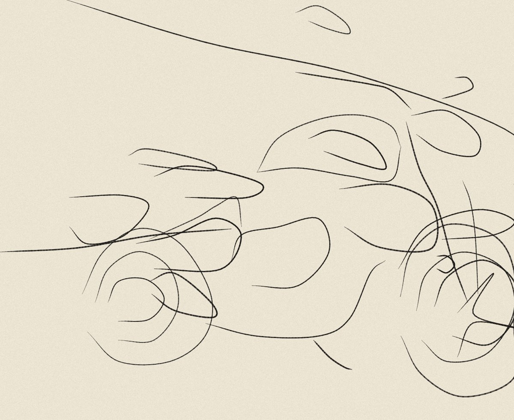
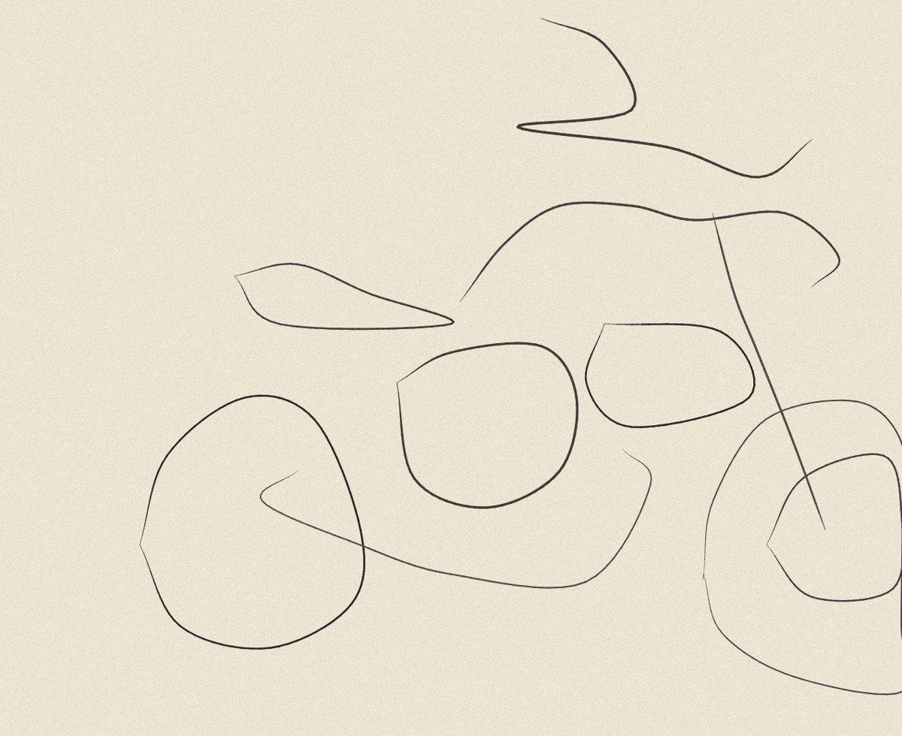
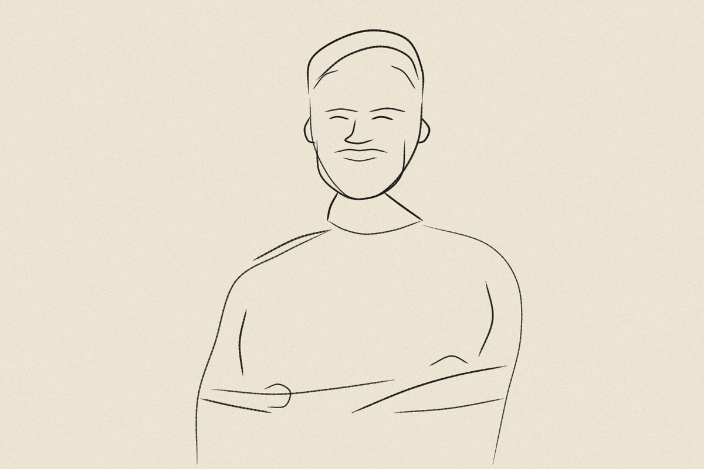
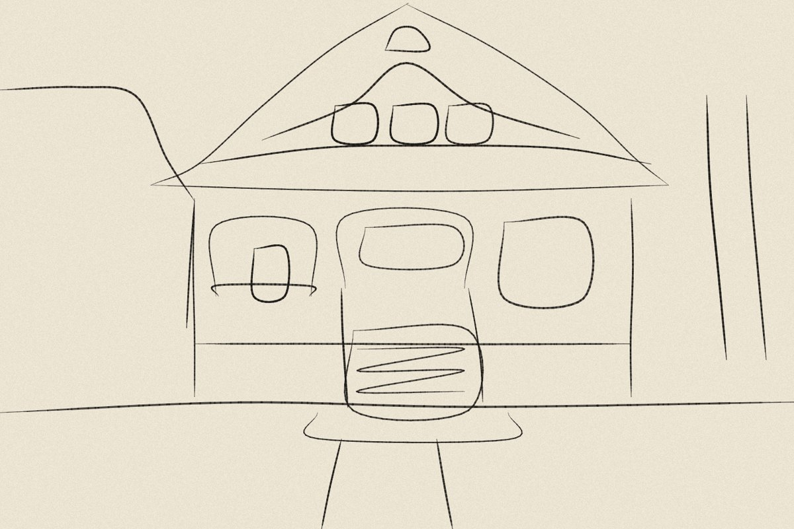

# Sketch Lab

**Constrained line drawing with a vision-language model**
Dan Bartlett · Independent Experimental Research · 2026

<p>
  
  
</p>

*The same photograph at two stroke budgets: 30 on the left, 10 on the right.*

*Sketch Lab* is a small drawing system. You give it a photograph and a number of strokes, and a vision-language model decides how to draw the image within that limit. The drawing appears stroke by stroke, with a label for each mark, on a sheet of cream paper.

## Why I made this

Drawing is largely a matter of deciding what to leave out. A quick sketch from life records what the person drawing thought was important, and two people drawing the same subject will rarely agree. I wanted to see what happens when that decision is handed to a machine, under the kind of pressure a short pose puts on a student in a drawing class.

Sketch Lab is also an example of system co-creation, the second mode of practice in my research. I wrote the constraints, the prompt and the renderer, working with Claude as a coding assistant. The model makes the drawing decisions. I chose the photographs and the budgets, and I am still working out how to describe my part in the drawings that result.

## How a drawing is made

The model is asked to work through four stages in order, and to write each one down before moving on. Nothing in the system forces that order; the prompt asks for it, and the written stages are shown alongside the finished drawing.

| | Stage | What the model writes |
| --- | --- | --- |
| 01 | Look | Two or three sentences on the subject, the mood and the light |
| 02 | Anchor | Eight to fifteen named landmarks with coordinates, such as the corner of an eye or the centre of a wheel |
| 03 | Plan | A numbered list of what each stroke will draw: outline first, then large forms, features and details, in proportion to the budget |
| 04 | Draw | Each stroke as a short list of points |

The renderer then smooths each list of points into a curve (a Catmull–Rom spline) and draws it as a line that thickens and tapers like pencil. Apart from a small random wobble and variation in line weight, that part is fixed procedure: every decision about what to draw is the model's.

The stroke budget can be set anywhere from 3 to 120. The prompt tells the model the budget and scales the outline, forms, features and details split to fit it, and the drawing is cut off at the budget if the model sends more.

## What the first drawings show

<p>
  
  
</p>

These come from one short session: four photographs at 30 strokes and one of them again at 10. One drawing per subject is not enough to generalise from, so I treat these as things to test.

- **The portrait was the most successful.** The hair, beard, smile, collar and crossed arms are all there, and the two people in the background were left out.
- **The house kept its structure,** but its straight edges came out rounded. That comes from the renderer, which smooths every stroke into a curve.
- **The tree and the motorcycle were weaker.** The canopy became a set of sweeping lines, and at 30 strokes the motorcycle became a tangle.
- **Cutting the motorcycle to 10 strokes made it clearer.** With fewer strokes, the model stopped drawing the background and stopped repeating itself.

## Running it

`index.html` is the whole tool, in one file. It works in two places.

### Inside Claude

Published as a Claude artifact, the page asks Claude to make each drawing, using the viewer's own Claude account. Nothing needs installing. The first drawing asks permission to use Claude and to send it the image.

### On your own machine, with a local model

Opened as a file on your computer, the page talks to a model server instead. By default it expects **Qwen3.8-27B-FP8** ([model card](https://huggingface.co/Qwen/Qwen3.8-27B-FP8)), served through vLLM.

1. **Start the model server** on a machine with a suitable GPU:
   ```bash
   pip install -U vllm
   vllm serve Qwen/Qwen3.8-27B-FP8 --max-model-len 32768
   ```
   The first start downloads the model weights. The server listens on port 8000. The shorter context length (32,768 tokens instead of the model's 262,144) is plenty for one image and a 120-stroke drawing, and leaves more memory free.
2. **Open the page.** Download `index.html` and double-click it.
3. **Check the connection.** Open **MODEL**, check the server address, and press **TEST**. It should report that the model is loaded.
4. **Draw.** Drop, paste or choose a photograph, set the stroke budget, and press **DRAW**.

Notes:

- **Another machine on your network:** start the server with `--host 0.0.0.0` and set SERVER to that machine's address, for example `http://zgx-nano.local:8000/v1`.
- **SGLang** works too: `python3 -m sglang.launch_server --model-path Qwen/Qwen3.8-27B-FP8 --port 30000`, with SERVER set to `http://localhost:30000/v1`.
- **Other models:** any OpenAI-compatible server with a vision model should work. Change MODEL to the name the server reports.
- **Thinking** is off by default. Qwen3.8 reasons before answering unless told not to, and for this task that mostly adds time. Switch it on under MODEL to compare.
- **API key:** only needed if you started vLLM with `--api-key`. Like the other settings, it is stored only in that browser.
- **Use the downloaded file, not the GitHub Pages link.** A page served from a website can't always reach a server on your own machine. Some browsers ask permission and some, including Safari, block the connection outright. If the browser reports the connection as blocked and you are using the file, check the server's CORS setting (vLLM's `--allowed-origins`).

So far the local engine has only been tested against a stand-in server that imitates vLLM's responses. The first runs on Qwen3.8 itself are still to come, and its drawings may differ a good deal from Claude's.

### Controls

- **Stroke budget:** slider, number box or presets (10, 30, 60, 100). It applies to the next drawing.
- **REDRAW:** the same image again, with one of five alternative approaches added to the prompt (gesture, construction, negative space, naive, caricature).
- **REPLAY:** draws the same strokes again without calling the model.
- **ANCHORS:** lays the model's landmarks over the drawing.
- **FULL ANALYSIS:** lists every landmark and the whole stroke plan.
- **SAVE:**
  - **PNG:** the drawing as an image.
  - **SVG:** the drawing with one editable path per stroke.
  - **JSON:** the full analysis.
- **SESSION LOG:** records every run with its engine, model, budget, timings and stroke counts, and saves as CSV.
- **Esc** stops a drawing.

## In this repository

| Path | What it is |
| --- | --- |
| `index.html` | The tool, as a single self-contained file with its fonts embedded |
| `source/sketch-lab.html` | The editable source of the tool. Run `python3 source/build.py` from the repository root to rebuild `index.html` |
| `source/v0.70/` | The original React version, which ran only inside Claude |
| `poster/` | The poster, as an A3 PDF and its editable HTML source |
| `docs/images/` | Drawings from the first test session |
| `docs/v0.70/` | The original reference notes, including a guide to running the earlier version on a local model through Hugging Face |

The source photographs from the test session are not included.

## Version history

- **v0.90:** runs outside Claude against a local model server (Qwen3.8-27B-FP8 by default).
- **v0.81:** stroke budget control; cleaner line rendering.
- **v0.80:** rebuilt as a working artifact with image files in place of URLs, and with the session log and saving added.
- **v0.70:** the original version, a React component that drew from image URLs.

The poster describes v0.81, the version used for the first test session.

## Credits

Written in plain JavaScript and HTML Canvas, with no libraries. The tool uses IBM Plex Mono and Source Serif 4, and the poster uses Gelasio and Courier Prime, all under the SIL Open Font Licence. Developed with coding assistance from Claude.

Reference: Catmull, E. and Rom, R. (1974) 'A class of local interpolating splines', in *Computer Aided Geometric Design*. Academic Press.

Companion pieces: [Dot-Matrix Mind](https://github.com/Barto86/dot-matrix-mind) and [Ninety-Two Layers](https://github.com/Barto86/ninety-two-layers).

© 2026 Dan Bartlett. All rights reserved for the text, images and design. Third-party fonts and models remain under their own licences.
